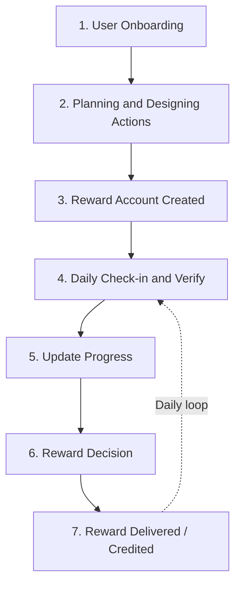

# Goal Tracking Agent

> A voice-first AI accountability agent that helps people finish what they start, using daily voice check-ins, emotion-aware coaching, a human accountability buddy, and real-world rewards.

**Status:** Design / architecture phase (no code yet). This repository documents the product flows, capability assessment, and the third-party "rails" the system is built on.

---

## Table of Contents

- [The Problem](#the-problem)
- [The Idea](#the-idea)
- [Key Features](#key-features)
- [How It Works](#how-it-works)
  - [Happy Flow](#happy-flow-ideal-situation)
  - [Unhappy Flows](#unhappy-flows)
- [Architecture: The Rails](#architecture-the-rails)
- [Capability Assessment](#capability-assessment)
- [Reward Design](#reward-design)
- [Safety and Ethics Guardrails](#safety-and-ethics-guardrails)
- [Tech Stack and Integrations](#tech-stack-and-integrations)
- [Repository Contents](#repository-contents)
- [Open Questions and Roadmap](#open-questions-and-roadmap)

---

## The Problem

Most people don't fail at goals because they lack a plan. They fail because motivation fades, life gets in the way, and nobody notices when they quietly stop. Existing habit apps are easy to ignore and easy to fake.

## The Idea

An AI agent that:

1. **Plans** a user's goal into achievable daily steps.
2. **Calls** the user every day, in their own language, to help them start.
3. **Verifies** the work through a short voice check-in and teach-back.
4. **Understands** how the user is feeling, and adapts the plan to their emotional state.
5. **Rewards** real progress with points and surprise physical gifts.
6. **Escalates** to a real human buddy when the user goes silent.

---

## Key Features

| Feature | Description |
|---|---|
| **Voice-first interaction** | Onboarding, daily nudges, and check-ins happen by voice, with text and voice-note fallback. |
| **Goal feasibility analysis** | Checks that a goal is achievable in the time available *before* the plan starts, and refuses to overload the user. |
| **Dynamic goal setting** | Daily tasks and schedule are updated every conversation based on progress and current emotional state. |
| **Emotional analysis** | Detects probable emotions from voice and text to adapt tone and task difficulty. |
| **Teach-back verification** | The user explains what they learned. The intelligence layer grades it so effort can't just be claimed. |
| **Location verification** | Where relevant, confirms the user is where they said they would be. |
| **Visualization exercises** | Personalized progress visualization and guided exercises to restore motivation. |
| **Hybrid rewards** | Weekly points in a prepaid brand wallet, plus mystery physical rewards shipped with an undisclosed delivery date. |
| **Human accountability buddy** | A friend of the user's choosing gets pinged on WhatsApp as a last resort. |
| **Guilt-free skip** | Lets users pause with no penalty after exceptional events such as an accident or illness. |
| **Graduation** | Rewards taper off once the habit settles, and the user receives a progress summary. |

---

## How It Works

### Happy Flow (Ideal Situation)



**1. Onboarding.** The user starts with a voice call and shares their goal, deadline, daily routine, and chosen accountability buddy.

**2. Planning.** The intelligence layer breaks the goal into daily steps, checks feasibility against the available time, and shows the plan to the user.

**3. Reward account.** A **Pine Labs Brand Wallet** is set up and the user's delivery address is confirmed.

**4. Daily check-in and verify.** At the user's chosen start time, the agent calls to help them begin. After the task, the user checks in by voice and gives a short teach-back, which is graded.

**5. Update progress.** Verified work updates the progress ledger, and the user sees how far they've come.

**6-7. Reward decision and delivery.** Each week, the reward policy releases earned points to the wallet and occasionally awards a surprise reward, which Delhivery ships without revealing the date.

The loop repeats until the deadline, or until the habit settles, at which point rewards taper off and the user graduates with a progress summary.

### Unhappy Flows

The system is designed to handle failure gracefully, at the technical level and the human level.

#### Technical and operational failures

| Failure | Response |
|---|---|
| Call break or disruption (noise, silence, language mismatch) | Retry, switch to text mode, or accept a voice note |
| Rail failure (payment or parcel) | Retry, or fall back to credit or reship |

#### Behavioral failures: the escalation ladder

```mermaid
flowchart TD
    A[User is not regular] --> B[LLM analyses user logs]
    B --> C[Finds the reason and generates a custom solution]
    C -->|User follows| D((+1))
    C -->|Still doesn't follow| E((-1))
    E --> F[System re-assesses its own thinking]
    F -->|Gamification, rewards, progress visualization| C
    F -->|Still no| G[AI asks real buddy to intervene]
```

1. **Trigger.** The workflow activates automatically when the system detects the user becoming inconsistent.
2. **Log analysis.** The intelligence layer reviews past progress and real-time voice emotion to find the root cause.
3. **Custom solution.** Using psychology-informed reasoning, it identifies the hurdle (for example a post-excitement dip, or burnout from complex tasks) and responds by:
   - Breaking overwhelming obstacles into **micro-tasks**.
   - **Pivoting** the task if an obstacle is unavoidable (for example, mentally recalling formulas while stuck travelling).
   - Pairing re-engagement with a **surprise physical reward** via Delhivery, if needed.
4. **Re-assessment loop.** If the user still doesn't follow through, a **-1** feedback signal makes the system rethink its approach using gamification, rewards, or progress visualization. If the user then follows the new plan, that registers as **+1**.
5. **Buddy escalation.** If the user remains unresponsive, the system asks their designated human accountability partner to check in. This step is grounded in survey insights: people are most likely to act when a friend holds them accountable.
6. **Worst-case override.** If the user cannot participate at all (for example, an accident requiring rest), the system grants a **guilt-free skip**.

Early misses (1st and 2nd miss, or user silence) are handled lightly with a **pass**, a **buddy ping**, or a **micro-task**. WhatsApp buddy ping is the **last resort**.

---

## Architecture: The Rails

The product is built on a set of external "rails" that handle specific capabilities, with an intelligence layer coordinating them. The system tracks, communicates, and validates through these rails.

```
                         ┌──────────────────────────────┐
                         │        Intelligence Layer     │
                         │  (LLM reasoning, planning,    │
                         │   emotion analysis, rewards)  │
                         └──────────────┬───────────────┘
                                        │
     ┌───────────────┬──────────────────┼───────────────┬────────────────┐
     │               │                  │               │                │
┌────▼─────┐   ┌─────▼──────┐    ┌──────▼─────┐   ┌─────▼──────┐   ┌─────▼──────┐
│  Voice   │   │  Payments  │    │  Delivery  │   │   Buddy    │   │  Location  │
│  Gnani   │   │ Pine Labs  │    │ Delhivery  │   │  WhatsApp  │   │ Maps / Geo │
│ STT/TTS  │   │  Wallet    │    │  B2C API   │   │  (Twilio)  │   │ validation │
└──────────┘   └────────────┘    └────────────┘   └────────────┘   └────────────┘
```

| Rail | Provider | Purpose |
|---|---|---|
| **Voice** | Gnani | Speech-to-text, text-to-speech, voice calls, voice cloning |
| **Intelligence** | Google Gemini (Interactions API), Hume (Empathic Voice Interface) | Planning, reasoning, emotion analysis |
| **Payments / Rewards** | Pine Labs prepaid API, Quicksilver | Brand wallet, points, vouchers, gift cards |
| **Logistics** | Delhivery (B2C API, maps/geocoding) | Mystery reward shipping, location validation |
| **Buddy channel** | Twilio WhatsApp Business API | Pinging the human accountability partner |

The whiteboard sessions also explored **buddy modes** (human buddy vs. AI buddy), additional **signals** such as camera, microphone, SMS/email, fitness data, and location, and a **proposed computer vision "4th rail"** for validating activity. These are noted as future directions below.

---

## Capability Assessment

Each capability was assessed for where it is used, what it takes in and returns, how it can fail, and what it must never do.

| # | Capability | Used at | Input → Output | Known failure | Must never | Provider |
|---|---|---|---|---|---|---|
| 1 | **Transcription** | Every interaction | Voice/text → text/voice | Switching between multiple languages | n/a | Gnani |
| 2 | **Voice cloning** | Fun interactions; motivating the user in a voice they value | Voice → voice | Poor cloning with mixed-language speech | n/a (for now) | Gnani |
| 3 | **Emotional analysis** | Every interaction, plus past context | Text + voice → probabilistic emotions (JSON) | Misses sarcasm | Compromise behavioral data or use it to gaslight the user | Hume EVI |
| 4 | **Ping human accountability partner** | After consecutive missed tasks | Ping request → confirmation | Buddy doesn't pay attention | Use WhatsApp access to compromise the user's data | Twilio WhatsApp Business API |
| 5 | **Goal feasibility analysis** | First conversation | Goals + intentions → feasible or not | none identified | Burden the user, even if they ask for it, since it can cause burnout | Gemini |
| 6 | **Dynamic goal setting and gamification** | Every conversation | Goals + current emotion → updated daily tasks and schedule | none identified | *(not specified)* | Gemini |
| 7 | **Visualization** | Every conversation | Task history + today's emotion → visualization exercise | none identified | Trigger panic by visualizing something traumatic | Gemini |
| 8 | **Reward analysis** | Every conversation | Task history + today's emotion → give reward or cut penalty | none identified | Ask for betting money upfront | Gemini |
| 9 | **Real-time thinking and interaction** | Every conversation | Task history + today's emotion → reasoned, voice-ready output | none identified | n/a | Gemini |
| 10 | **Location verification** | When the user should be somewhere | Current location + expected location → true/false | User's workplace is near their hangout spot | Misuse location data | Delhivery maps / geocoding and reverse geocoding |
| 11 | **Vouchers and gift cards** | Crediting rewards or debiting penalties | Reward/penalty trigger → confirmation | User doesn't care about money | Misuse payment details | Quicksilver |

All eleven capabilities are currently assessed as **"Exists"**, meaning they can be built on existing provider APIs rather than from scratch.

---

## Reward Design

The reward mechanism is designed for the **worst case**: a user who is trying to game the system.

- **Points (predictable):** earned weekly based on verified work and released to the user's Pine Labs Brand Wallet.
- **Mystery rewards (unpredictable):** physical rewards aligned to the user's goal, shipped by Delhivery with an **undisclosed delivery date**, so users can't fake their way through a stretch just to collect a reward.
- **Verification before reward:** teach-back grading (and location checks where relevant) must pass before progress is logged.
- **Tapering:** as the habit settles, rewards fade out so the behavior becomes intrinsic.
- **No upfront betting money:** the system never asks the user to stake cash in advance.

---

## Safety and Ethics Guardrails

These "must never" rules come directly from the capability assessment:

- **Behavioral data is private.** It is never compromised, and never used to gaslight or manipulate the user.
- **Buddy channel is limited.** WhatsApp access is used only to ping the buddy, never to access the user's data.
- **No overload.** Feasibility analysis must refuse plans that risk burnout, even if the user insists.
- **No trauma triggers.** Visualization exercises must avoid anything likely to cause panic.
- **Payment safety.** Payment details are never misused, and no upfront betting money is requested.
- **Location privacy.** Location data is used only for verification.
- **Guilt-free skip.** Users in genuine hardship are not penalized.

---

## Tech Stack and Integrations

| Area | Technology |
|---|---|
| Voice AI | [Gnani](https://www.gnani.ai/) (STT, TTS, voice calls, cloning) |
| LLM / reasoning | Google Gemini (Interactions API) |
| Emotion detection | Hume Empathic Voice Interface (EVI) |
| Messaging | Twilio WhatsApp Business API |
| Rewards / wallet | Pine Labs prepaid API, Quicksilver |
| Logistics and maps | Delhivery B2C API, geocoding and reverse geocoding |

> Refer to each provider's official documentation for API specifics.

---

## Repository Contents

```
Goal_Tracking_Agent_Design/
└── Ken Round 2/
    ├── Whole Flow.jpeg                      # Whiteboard of the full system, rails and capabilities
    ├── unhappy_flow.jpeg                    # Whiteboard of the escalation ladder
    ├── Happy and unhappy flow.pdf           # Hand-drawn happy flow and unhappy flows (3 pages)
    ├── Happy_Unhappy Flow Description_.docx # Written description of both flows
    ├── Capabilities_.docx                   # 11-capability assessment
    └── Links To LLM used.docx               # Links to the ChatGPT, Claude and Gemini sessions used
```

---

## Open Questions and Roadmap

Ideas raised during design that aren't yet resolved:

- [ ] **Computer vision as a 4th rail** to validate physical activity and study sessions.
- [ ] **AI buddy vs. human buddy:** the whiteboard sketches a choice between the two, and an AI buddy fallback for users without one.
- [ ] **Fitness and motion data** as an additional validation signal.
- [ ] **Additional channels** such as SMS and email, with WhatsApp limited to the buddy ping.
- [ ] **Fixed-goal vs. open-ended habits**, and how the reward policy differs.
- [ ] **Multilingual robustness** for transcription and voice cloning in mixed-language speech.
- [ ] **Sarcasm handling** in emotion detection.
- [ ] **Edge case:** users who are indifferent to monetary rewards.
- [ ] **Edge case:** location verification when the workplace is near a "hangout" spot.
- [ ] Document the system "in such a way that anyone can build based on it", per the whiteboard note.

---

## Contributing

This project is at the design stage. Feedback on the flows, capability assessment, and safety guardrails is welcome via issues and pull requests.

## License

*To be decided.*
